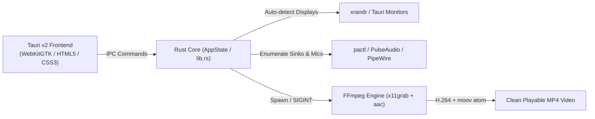

# Esperanza Screen Capture (v2.0)

[](https://github.com)
[-3b82f6.svg?style=flat-square)](https://github.com)
[](https://tauri.app)
[](https://ffmpeg.org)
[](https://github.com)

> **Lightweight, high-performance Linux screen recording built with Rust and Tauri v2.**  
> Pure screen capture • Native H.264/AAC • Zero watermarks • Automatic multi-monitor detection.

---

## 🌟 Why Esperanza Screen Capture?

Most modern screen recorders on Linux are built on top of heavy Electron runtimes that consume hundreds of megabytes of RAM and drop frames under load. 

**Esperanza Screen Capture** was built from the ground up using **Rust**, **Tauri v2**, and a direct **FFmpeg `x11grab` pipeline**. It launches instantly, uses under 30MB of memory, and produces clean, uncompressed, fully finalized MP4 recordings with guaranteed `moov` atom integrity on exit.

---

## ✨ Features

- 🖥️ **Smart Display & Monitor Auto-Detection (v2.0)**  
  Queries connected hardware on startup via `xrandr` and Tauri monitor APIs. Automatically detects primary screens, secondary monitors, exact native resolutions, and X/Y coordinate offsets. Generates one-click presets for single screens, dual screens, and combined multi-monitor desktops.

- ⚡ **Pure Native H.264 & AAC Encoding**  
  Records directly using FFmpeg `libx264` and `aac` without re-encoding passes or proprietary containers. Unblocked stream pipes prevent kernel buffer deadlocks, while clean `SIGINT` interruption ensures the MP4 `moov` header atom is fully written in under 0.1s.

- 🎙️ **Dual Audio Capture Modes**  
  - **With Sound**: Automatically enumerates PulseAudio and PipeWire hardware sources. Record **Desktop Audio** (browser, game, media playback via `.monitor` sinks) or your **Microphone**.
  - **Without Sound**: Silent, ultra-low-latency capture.

- 🎯 **Interactive Screen Selector & Guide Frame**  
  - **Click & Drag Overlay**: Crosshair selection window with 8 resize handles and instant dimension badges.
  - **Size Fine-Tuning**: Stepper buttons to nudge Width and Height by `±10px` or `±50px`.
  - **Visual Border Frame**: Toggleable live neon border outline around your recording area on screen so you always know what is inside the frame.

- 📁 **Integrated Recordings Manager**  
  Browse recent MP4 recordings directly inside the app with file sizes and timestamps. One-click **Play** (via your system's default media player) or **Show in Folder**.

- 🌑 **Sleek Dark Obsidian UI**  
  Engineered with high-contrast, eye-friendly dark aesthetics (`#0f1117` / `#151822`) with zero light-theme bleed.

- 📦 **Dual Packaging**:  
  - **AppImage**: Zero-install, portable single-file binary that runs on any Linux distribution without root.
  - **`.deb` Installer**: Standard Debian package that automatically resolves and installs system dependencies (`ffmpeg`, `zenity`, `libwebkit2gtk`).

---

## 📥 Installation & Downloads

### Option A: Portable AppImage (All Linux Distros)
No installation or root privileges required.

1. Download **`EsperanzaScreenCapture-v2.AppImage`**.
2. Make it executable:
   ```bash
   chmod +x EsperanzaScreenCapture-v2.AppImage
   ```
3. Run:
   ```bash
   ./EsperanzaScreenCapture-v2.AppImage
   ```

### Option B: `.deb` Package (Ubuntu, Debian, Linux Mint, Pop!_OS)
Installs system-wide to `/usr/bin/` with application menu shortcuts.

1. Download **`esperanza-capture_2.0.0_amd64.deb`**.
2. Install via `apt` (which automatically downloads missing libraries):
   ```bash
   sudo apt install ./esperanza-capture_2.0.0_amd64.deb
   ```
   *(Or simply double-click the `.deb` file in your desktop file manager to install via Ubuntu Software / GDebi).*

---

## 🚀 Quick Usage Walkthrough

1. **Select Region**:
   - Click one of the **Auto-detected Display Presets** (e.g. *Primary 1920×1080*, *DisplayPort 1366×768*, or *All Screens*).
   - Or click **Select Area with Mouse** to drag a custom bounding box over any window or portion of your screen.
2. **Audio Setup**:
   - Choose **With Sound** (select your speakers/headphones `.monitor` sink for desktop sound, or select your microphone).
   - Or choose **Without Sound** for silent video.
3. **Capture Options**:
   - Set desired framerate (15, 24, 25, 30, or 60 FPS).
   - Set quality level (CRF 18 visually lossless to CRF 28 compressed).
   - Toggle **Capture Mouse Cursor**.
4. **Record**:
   - Hit **Start Recording** (or press <kbd>Space</kbd>).
   - Hit **Stop Recording** when finished. The MP4 is immediately available in the bottom recordings list!

---

## 🛠️ Architecture & Tech Stack



- **Frontend**: Vanilla ES6+ & CSS3 with WebKitGTK. Fast, zero build step for the UI, custom dark theme.
- **Backend**: Rust 2024 edition with Tauri v2 (`tauri`, `libc`, `chrono`, `serde`).
- **Screen Capture**: FFmpeg using `-f x11grab` with asynchronous thread queuing (`-thread_queue_size 1024`).
- **Audio Engine**: PulseAudio / PipeWire subsystem with `aresample=async=1000` drift correction.
- **Display Detection**: Hardware geometry parsing via `xrandr --query` with fallback to `tauri::Monitor`.

---

## 🔨 Building from Source

### Prerequisites
- Linux OS with X11 display server
- Rust & Cargo (1.80+)
- Node.js & npm
- System packages:
  ```bash
  sudo apt install build-essential libwebkit2gtk-4.1-dev libgtk-3-dev ffmpeg zenity pulseaudio-utils
  ```

### Build Steps
1. Clone the repository:
   ```bash
   git clone https://github.com/your-username/esperanza-screen-capture.git
   cd esperanza-screen-capture
   ```

2. Run in development mode:
   ```bash
   npx @tauri-apps/cli dev
   ```

3. Build production bundles:
   ```bash
   # Build AppImage
   npx @tauri-apps/cli build --bundles appimage

   # Build Debian package (.deb)
   npx @tauri-apps/cli build --bundles deb
   ```
   Outputs will be located in `src-tauri/target/release/bundle/`.

---

## 📋 System Requirements

| Requirement | Recommendation |
| :--- | :--- |
| **Operating System** | Ubuntu 20.04+, Debian 11+, Linux Mint 20+, Fedora 36+, Arch Linux |
| **Display Server** | X11 (Xorg) |
| **Recording Engine** | `ffmpeg` (installed by default or via `.deb` dependencies) |
| **Audio Server** | PulseAudio or PipeWire (`pulseaudio-utils` / `pactl`) |
| **Dialog Helper** | `zenity` (for native directory selection) |

---

## 📄 License

Distributed under the **MIT License**. See `LICENSE` for details.
Designed and built with care by Esperanza & Jack.
